This working copy keeps only panels shown in the supplied outline. Run from
this repository root with `Rscript figure/fig1/render.R`. Generated panel SVGs
are in each panel's `generated/` directory. Edit the assembled `figure1.svg`;
re-rendering replaces its named data groups, preserving the surrounding layout.


``` r
library(data.table)
library(GeneralDualSimplex)
library(ggplot2)
library(ggh4x)
library(magrittr)
f <- glue::glue
pmap <- purrr::pmap
source("figure/fig1/simulation_helpers.R", local = TRUE)
source("figure/fig1/export_helpers.R", local = TRUE)
knitr::opts_chunk$set(dev = "svglite", fig.ext = "svg",
  fig.path = "figure/fig1/render/", echo = FALSE, message = FALSE,
  warning = TRUE, cache = FALSE, fig.show = "hide")
theme_set(theme_classic(base_family = "Liberation Sans", base_size = 5.5))
update_geom_defaults("point", list(size = 0.35, stroke = 0.15))
update_geom_defaults("line", list(linewidth = 0.15))
update_geom_defaults("polygon", list(linewidth = 0.15))
update_geom_defaults("boxplot", list(linewidth = 0.15, size = 0.3))
inputs <- list()
```


# Load the supplied simulations


# B — feature simplices only


```
## panelB/feature-none : 16.4 x 18 mm
```

```
## panelB/feature-Poisson : 16.4 x 18 mm
```

```
## panelB/feature-NB : 16.4 x 18 mm
```

```
## panelB/feature-Normal : 16.4 x 18 mm
```

```
## panelB/feature-Mul : 16.4 x 18 mm
```

# C — deconvolution RMSE


```
## panelC/rmse-W : 43 x 37 mm
```


```
## panelC/rmse-H : 43 x 37 mm
```

# D — variance share by rank and expression bin


```
## Warning in `[.data.table`(fdata, , `:=`(mass_sum = sum(total), sacling_sum =
## sum(scaling), : A shallow copy of this data.table was taken so that := can add
## or remove 5 columns by reference. At an earlier point, this data.table was
## copied by R (or was created manually using structure() or similar). Avoid
## names<- and attr<- which in R currently (and oddly) may copy the whole
## data.table. Use set* syntax instead to avoid copying: ?set, ?setnames and
## ?setattr. It's also not unusual for data.table-agnostic packages to produce
## tables affected by this issue. If this message doesn't help, please report your
## use case to the data.table issue tracker so the root cause can be fixed or this
## message improved.
```


```
## panelD/rank : 47 x 37 mm
```


```
## Warning in min(x): no non-missing arguments to min; returning Inf
```

```
## Warning in max(x): no non-missing arguments to max; returning -Inf
```

```
## Warning in min(x): no non-missing arguments to min; returning Inf
```

```
## Warning in max(x): no non-missing arguments to max; returning -Inf
```

```
## panelD/bins : 34 x 37 mm
```

# E — signal/noise variance shares and SNR


```
## panelE/by-bin : 77 x 40 mm
```


```
## panelE/total : 43 x 40 mm
```


```
## panelE/snr : 50 x 40 mm
```

# F — spectral separation


```
## panelF/spectrum : 52 x 39 mm
```


```
## panelF/ratio : 65 x 39 mm
```


```
## panelF/snr-ratio : 53 x 39 mm
```

# G — projection RMSE and its fraction of deconvolution RMSE


```
## panelG/projection-W : 54 x 36 mm
```


```
## panelG/projection-H : 54 x 36 mm
```


```
## Warning in `[.data.table`(plot_data_wide, , `:=`(oracle_rmse_pct =
## (oracle_rmse/rmse))): A shallow copy of this data.table was taken so that :=
## can add or remove 1 columns by reference. At an earlier point, this data.table
## was copied by R (or was created manually using structure() or similar). Avoid
## names<- and attr<- which in R currently (and oddly) may copy the whole
## data.table. Use set* syntax instead to avoid copying: ?set, ?setnames and
## ?setattr. It's also not unusual for data.table-agnostic packages to produce
## tables affected by this issue. If this message doesn't help, please report your
## use case to the data.table issue tracker so the root cause can be fixed or this
## message improved.
```


```
## panelG/fraction : 62 x 36 mm
```


```
## Retained simulations: 340
```

```
## Seeds: 20
```

```
## Representative simplex: seed 17 noise level 1/2
```

```
## D and E selected noise level: 1/4; noiseless baseline retained in D.
```

# SVG gallery


## Panel B

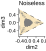

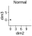

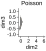

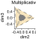

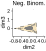


## Panel C

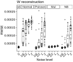

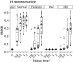


## Panel D


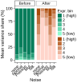


## Panel E

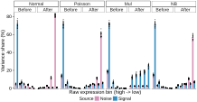

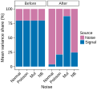

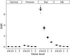


## Panel F

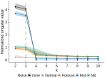

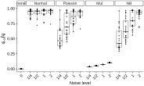

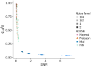


## Panel G

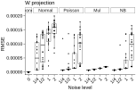

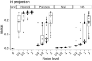

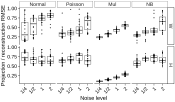

